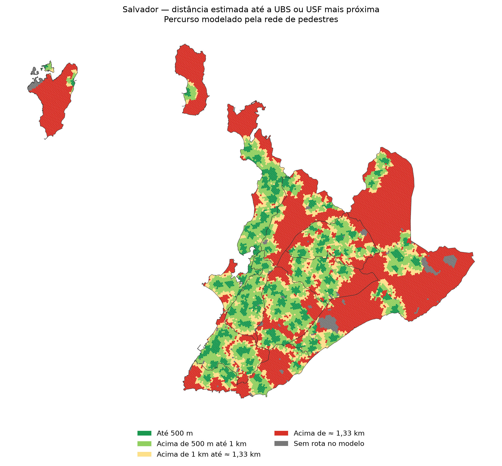
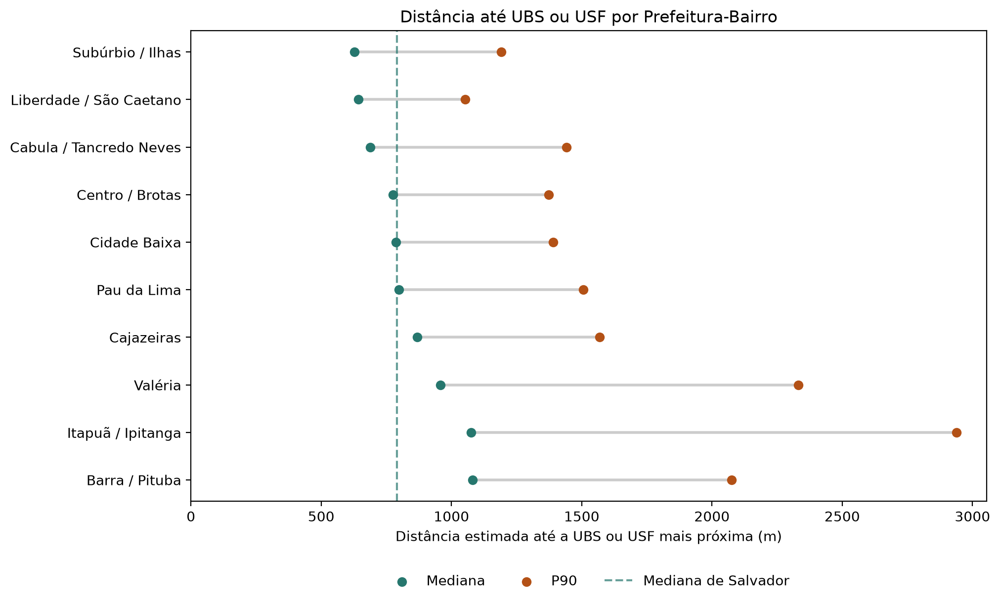

# Distância da população de Salvador até a UBS ou USF mais próxima

Projeto final do **Future Tech Leaders**, desenvolvido por **Emanuel Brito**.

O estudo estima a distância da população de Salvador até a Unidade Básica de Saúde (UBS) ou Unidade de Saúde da Família (USF) mais próxima, considerando percursos modelados na rede de pedestres do OpenStreetMap. A análise começou com um piloto em Centro/Brotas e foi ampliada para as dez Prefeituras-Bairro de Salvador.

A **distância em metros** é o resultado principal. O tempo de caminhada é apresentado apenas como referência complementar, utilizando velocidade constante de 4 km/h. Portanto, o projeto não mede o acesso efetivo ao atendimento de saúde.



*O mapa representa as células H3 por faixas de distância estimada. Os percentuais apresentados neste documento são ponderados pela população estimada das células, e não pela área ocupada por cada cor.*

## Objetivo

Quantificar a distância estimada da população de Salvador até a UBS ou USF mais próxima pela rede de pedestres e comparar a distribuição dessas distâncias entre as dez Prefeituras-Bairro.

Como análises complementares, o projeto também compara:

- a quantidade de UBS e USF instaladas por 10 mil habitantes;
- a conversão das distâncias em tempo estimado de caminhada;
- um indicador exploratório de rendimento por Prefeitura-Bairro.

## Relação com os Objetivos de Desenvolvimento Sustentável

O projeto se relaciona principalmente com o **ODS 3 — Saúde e Bem-Estar**, especialmente por produzir evidências espaciais que podem ajudar na discussão sobre a proximidade da população aos serviços de atenção primária à saúde.

Também dialoga com o **ODS 10 — Redução das Desigualdades** e o **ODS 11 — Cidades e Comunidades Sustentáveis**, ao comparar diferenças territoriais entre as regiões de Salvador.

## Principais resultados

A análise utilizou **18.317 células H3 de resolução 10**, contendo aproximadamente **2,41 milhões de pessoas estimadas** no recorte das Prefeituras-Bairro.

Entre a população estimada em células para as quais o modelo encontrou rota, a distância média ponderada foi de **949 m**, a mediana de **790 m**, o P75 de **1.197 m** e o P90 de **1.739 m**. O P90 indica que 90% dessa população ficou em células cuja distância estimada até a unidade mais próxima foi de até aproximadamente 1.739 m.

| Faixa de distância | Percentual de toda a população estimada |
|---|---:|
| Até 500 m | 24,36% |
| Acima de 500 m até 1 km | 40,32% |
| Acima de 1 km até aproximadamente 1,33 km | 15,12% |
| Acima de aproximadamente 1,33 km, com rota | 19,72% |
| Sem rota no modelo | 0,48% |

No total, **64,68%** da população estimada ficou a até **1 km** da unidade mais próxima e **79,80%** a até aproximadamente **1,33 km** — distância equivalente a 20 minutos no cenário complementar de caminhada a 4 km/h.

O modelo não encontrou rota para **404 células**, que somaram cerca de **11,5 mil pessoas estimadas**. Esses casos foram mantidos separados das células com percursos superiores a 1,33 km.

**Itapuã/Ipitanga** e **Barra/Pituba** apresentaram medianas próximas, de **1.076 m** e **1.082 m**, respectivamente. A diferença apareceu principalmente nos percursos mais longos: o P90 foi de **2.938 m** em Itapuã/Ipitanga e de **2.076 m** em Barra/Pituba. Juntas, as duas regiões concentraram cerca de **280 mil pessoas estimadas fora da faixa de até 1,33 km**, incluindo os casos sem rota.



## Dados utilizados

| Fonte | Uso no projeto |
|---|---|
| [Salvador Dados](https://geo.salvador.ba.gov.br/portal/apps/sites/#/salvador-dados) | Limites dos 171 bairros, limites das dez Prefeituras-Bairro e camada geográfica das unidades de saúde. |
| [IBGE — Censo Demográfico 2022](https://www.ibge.gov.br/estatisticas/sociais/populacao/22827-censo-demografico-2022.html) | Malha, população e variáveis de rendimento dos setores censitários. |
| [OpenStreetMap](https://www.openstreetmap.org/copyright) | Rede de circulação de pedestres utilizada na modelagem dos percursos. |

As fontes foram acessadas em **novembro de 2026**. A camada de unidades de saúde utilizada possui metadados de 2021, e o funcionamento atual das unidades não foi verificado.

Os dados brutos não estão incluídos no repositório. Para reproduzir integralmente a análise, é necessário baixar as bases originais e organizá-las em `dados/brutos/`, seguindo os caminhos utilizados nos notebooks.

## Metodologia

### 1. Organização territorial

Os **171 bairros oficiais** foram explorados como referência territorial. As **dez Prefeituras-Bairro** foram utilizadas para delimitar a área do estudo e apresentar os indicadores regionais. As divisas administrativas serviram para resumir os resultados, mas não impediram que uma rota atravessasse de uma região para outra.

### 2. Estimativa da população na grade H3

Após o tratamento de códigos repetidos e geometrias distintas, foram utilizados **4.542 setores censitários** do Censo 2022. A população foi distribuída proporcionalmente à área de interseção entre os setores e **18.317 células H3 de resolução 10**.

A soma populacional dos setores inteiros era de **2.417.678 pessoas**. O recorte pelos limites das Prefeituras-Bairro resultou em **2.410.231,79 pessoas estimadas**, total preservado na distribuição para a grade H3. A diferença de **7.446,21 pessoas estimadas** surgiu no rateio por área das parcelas de setores situadas fora dos limites utilizados e não representa uma contagem observada de moradores fora do município.

Essa abordagem pressupõe que a população esteja uniformemente distribuída dentro de cada setor censitário. Por isso, os valores das células são estimativas, e não contagens oficiais.

### 3. Unidades de saúde

Foram consideradas **142 unidades** presentes na base utilizada:

- **45 UBS**;
- **97 USF**.

O número de unidades por 10 mil habitantes foi calculado como indicador complementar de oferta nominal. Esse indicador não representa capacidade de atendimento, disponibilidade de consultas ou área oficial de abrangência das unidades.

### 4. Distâncias pela rede de pedestres

Com **OSMnx** e **NetworkX**, foi estimado o menor percurso entre um ponto representativo de cada célula H3 e a UBS ou USF mais próxima pela rede de pedestres do OpenStreetMap.

A distância final inclui:

- a ligação estimada em linha reta entre a origem e a rede;
- o menor percurso encontrado na rede de pedestres;
- a ligação estimada em linha reta entre a rede e a unidade de saúde.

Os componentes desconectados da rede foram mantidos para permitir a modelagem de rotas locais, inclusive nas ilhas. Quando o modelo não encontrou uma conexão válida no grafo utilizado, a célula foi classificada como **sem rota no modelo**.

### 5. Validação amostral

A conferência amostral incluiu:

- um percurso curto em Centro/Brotas;
- dois percursos longos, em Itapuã/Ipitanga e Barra/Pituba;
- um percurso com escadaria mapeada no Calabar;
- um percurso local na Ilha de Maré;
- dois casos classificados como sem rota.

A inspeção verificou a coerência do cálculo e dos caminhos registrados no grafo, mas não constitui validação em campo.

## Análises complementares

### Unidades por 10 mil habitantes

O indicador compara a quantidade de UBS e USF instaladas em cada Prefeitura-Bairro com sua população estimada. Ele responde a uma pergunta diferente da distância pela rede: uma região pode apresentar quantidade semelhante de unidades por habitante e, ainda assim, ter uma distribuição espacial menos favorável.

### Rendimento

Foi construído um indicador exploratório a partir do rendimento médio mensal dos responsáveis pelo domicílio com rendimento (`V06004`). Os valores setoriais foram ponderados pelo total de responsáveis pelo domicílio (`V06001`) e pela proporção da área de cada setor dentro da região.

Como a base utilizada não informa quantos responsáveis possuem rendimento, o resultado não deve ser interpretado como uma média regional exata nem como renda domiciliar per capita.

A correlação de Spearman entre o indicador de rendimento e a proporção da população situada a até aproximadamente 1,33 km foi de **−0,47**. Trata-se de uma associação descritiva entre apenas dez regiões, sem interpretação causal ou individual.

## Resultados gerados

- [Mapa municipal por faixas de distância](resultados/mapas/distancia_ubs_usf_salvador.png)
- [Gráfico de mediana e P90 por Prefeitura-Bairro](resultados/graficos/distancia_ubs_usf_por_prefeitura_bairro.png)
- [Indicadores consolidados por Prefeitura-Bairro](resultados/tabelas/indicadores_por_prefeitura_bairro_revisado.csv)
- [Faixas de distância da população de Salvador](resultados/tabelas/faixas_distancia_salvador.csv)
- [Gráfico de rendimento e cobertura em até 20 minutos](resultados/graficos/renda_e_cobertura_ubs_usf.png)


## Mapa interativo

A página interativa permite explorar os resultados por Prefeitura-Bairro:

- seleção de região com destaque, zoom e painel de indicadores;
- localização das 45 UBS e 97 USF, com símbolos diferentes e filtros;
- limites opcionais dos 171 bairros, com nome e região associada;
- localização e endereço das dez sedes das Prefeituras-Bairro;
- legenda dos símbolos e avisos metodológicos.

Os indicadores são regionais. A camada de bairros não apresenta
estimativas calculadas por bairro.

### Preparação dos dados

O script Python lê as bases geográficas e o CSV regional revisado,
valida os dados, associa bairros e unidades às regiões e exporta
os arquivos consumidos pela página.

Na raiz do projeto, execute:

```bash
uv sync
uv run python src/preparar_dados_mapa.py
```

Os arquivos de entrada precisam estar nos caminhos definidos no script.
Os dados brutos não estão incluídos no repositório.

### Executar o mapa localmente

Com os arquivos exportados disponíveis em `site/mapa/dados/`, execute
na raiz do projeto:

```bash
uv run python -m http.server 8000 --bind 127.0.0.1 --directory site
```

Abra **http://localhost:8000/mapa/** no navegador.
Para encerrar o servidor, pressione **Ctrl + C** no terminal.

### Organização

| Arquivo ou pasta | Função |
|---|---|
| `src/preparar_dados_mapa.py` | Preparação, validação e exportação dos dados em Python. |
| `site/mapa/index.html` | Estrutura da página. |
| `site/mapa/mapa.css` | Aparência e layout responsivo. |
| `site/mapa/app.js` | Carregamento dos arquivos e interações com Leaflet. |
| `site/mapa/dados/` | GeoJSONs e JSON de indicadores exportados pelo Python. |

A página não possui backend e não recalcula rotas durante a navegação.
Os dados são carregados dos arquivos exportados; a biblioteca Leaflet
é carregada por CDN e requer conexão com a internet.

### Limitações específicas do mapa

- As cores das Prefeituras-Bairro apenas identificam os territórios.
- A associação dos bairros usa a maior área de sobreposição com cada
  Prefeitura-Bairro, preservando os polígonos originais.
- A base de UBS e USF possui metadados de 2021; o funcionamento atual
  das unidades não foi verificado.
- A base das sedes apresenta divergência no número do endereço de
  Liberdade/São Caetano. O pop-up mantém os campos originais e sinaliza
  a pendência de confirmação.


## Tecnologias utilizadas

- Python 3.10 ou superior;
- uv;
- GeoPandas;
- H3;
- Matplotlib;
- OSMnx;
- NetworkX;
- SciPy;
- Jupyter Notebook;
- Ubuntu no WSL 2.

## Como reproduzir a análise

### 1. Clonar o repositório

```bash
git clone https://github.com/Emanuelbrit96/ftl-projeto-final.git
cd ftl-projeto-final
```

### 2. Instalar as dependências

Com o [uv](https://docs.astral.sh/uv/) instalado, execute:

```bash
uv sync
```

O comando cria ou atualiza o ambiente virtual `.venv` com as dependências registradas no `pyproject.toml` e no `uv.lock`.

### 3. Preparar os dados

Baixe as bases indicadas na seção **Dados utilizados** e organize os arquivos dentro de `dados/brutos/`, conforme os caminhos definidos nos notebooks. Essa pasta é ignorada pelo Git e, portanto, não é baixada com o repositório.

### 4. Abrir os notebooks

Abra o projeto no VS Code ou em outro ambiente compatível com Jupyter e selecione como kernel o Python da pasta `.venv`.

## Fluxo de execução dos notebooks

| Etapa | Notebook | Finalidade |
|---:|---|---|
| 01 | [`01_exploracao_bairros.ipynb`](notebooks/01_exploracao_bairros.ipynb) | Explora e valida nomes, geometrias e sistema de coordenadas dos 171 bairros oficiais. |
| 02 | [`02_exploracao_pref_bairros.ipynb`](notebooks/02_exploracao_pref_bairros.ipynb) | Explora as dez Prefeituras-Bairro e seleciona Centro/Brotas como piloto. |
| 03 | [`03_grade_h3_piloto.ipynb`](notebooks/03_grade_h3_piloto.ipynb) | Gera a grade H3 de resolução 10 e recorta as células pelos limites do piloto. |
| 04 | [`04_exploracao_populacao.ipynb`](notebooks/04_exploracao_populacao.ipynb) | Trata os setores censitários e estima a população das células do piloto. |
| 05 | [`05_exploracao_ubs_usf.ipynb`](notebooks/05_exploracao_ubs_usf.ipynb) | Limpa e classifica os registros de UBS e USF e identifica as unidades no piloto. |
| 06 | [`06_proximidade_ubs_usf.ipynb`](notebooks/06_proximidade_ubs_usf.ipynb) | Calcula a distância em linha reta até a unidade mais próxima no piloto. |
| 07 | [`07_rede_caminhada_osmnx.ipynb`](notebooks/07_rede_caminhada_osmnx.ipynb) | Prepara a rede de pedestres e testa o roteamento em Centro/Brotas. |
| 08 | [`08_grade_populacao_salvador.ipynb`](notebooks/08_grade_populacao_salvador.ipynb) | Gera a grade municipal, estima a população por célula e distribui a população entre as Prefeituras-Bairro. |
| 09 | [`09_rede_caminhada_salvador.ipynb`](notebooks/09_rede_caminhada_salvador.ipynb) | Estima as distâncias pela rede municipal, valida uma amostra de rotas e gera tabelas e visualizações. |
| 10 | [`10_renda_acessibilidade.ipynb`](notebooks/10_renda_acessibilidade.ipynb) | Calcula o indicador exploratório de rendimento e consolida os indicadores regionais. |

Na primeira execução completa, algumas etapas municipais precisam ser intercaladas devido às dependências entre os arquivos produzidos:

1. execute o notebook `08` até gerar a grade municipal e a população por célula e Prefeitura-Bairro;
2. execute o notebook `09` até salvar as distâncias por célula;
3. retorne ao notebook `08` para gerar a tabela regional utilizada na etapa seguinte;
4. execute o notebook `10` e salve o primeiro CSV consolidado;
5. retorne ao notebook `09` para exportar o CSV regional revisado e gerar as figuras finais.

## Estrutura do projeto

```text
ftl-projeto-final/
├── dados/
│   ├── brutos/          # bases originais não versionadas pelo Git
│   └── processados/     # dados produzidos durante a análise
├── notebooks/           # etapas exploratórias e analíticas
├── resultados/
│   ├── graficos/
│   ├── mapas/
│   └── tabelas/
├── src/
├── pyproject.toml
├── uv.lock
└── README.md
```

## Limitações

- A população foi distribuída proporcionalmente à área dentro dos setores censitários, o que pressupõe distribuição espacial uniforme.
- O ponto representativo de cada célula H3 é uma aproximação da origem dos moradores.
- As rotas dependem da cobertura e da qualidade dos caminhos registrados no OpenStreetMap.
- As ligações em linha reta entre as células, a rede e as unidades não foram verificadas em campo.
- **Sem rota no modelo** significa que não foi encontrada uma conexão válida no grafo utilizado; não significa necessariamente inexistência de percurso no território real.
- Os metadados da camada de unidades de saúde são de **2021**, e o funcionamento atual das unidades não foi confirmado.
- A análise não considera relevo, declividade, segurança, qualidade das calçadas, restrições individuais de mobilidade ou outros modos de transporte.
- O estudo não avalia disponibilidade de consultas, horários de funcionamento, capacidade de atendimento ou regras de encaminhamento das unidades.
- O indicador de rendimento é aproximado e não permite conclusões causais nem individuais.

## Trabalhos futuros

- incorporar relevo e declividade à modelagem dos percursos;
- avaliar isócronas e diferentes velocidades de caminhada;
- validar e atualizar o cadastro das UBS e USF;
- considerar capacidade e funcionamento das unidades;
- investigar outros modos de deslocamento;
- aprofundar a análise das desigualdades territoriais;
- reorganizar as etapas municipais em um fluxo automatizado e sequencial.

## Autor

**Emanuel Brito**

- [GitHub](https://github.com/Emanuelbrit96)
- [LinkedIn](https://www.linkedin.com/in/emanuelbrit-o/)

## Atribuição

Os dados da rede viária são provenientes do OpenStreetMap: © colaboradores do OpenStreetMap, disponibilizados sob a licença ODbL.
